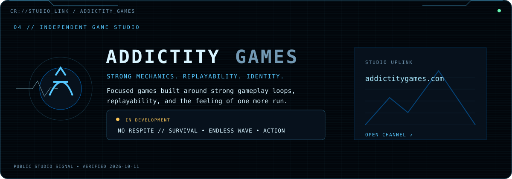
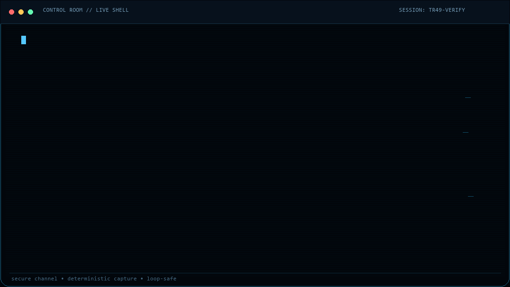
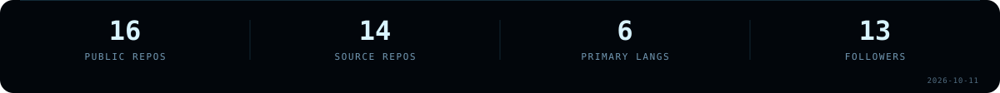

<picture>
  <source media="(prefers-reduced-motion: reduce)" srcset="assets/hero-static.svg">
  
</picture>

<picture>
  <source media="(prefers-reduced-motion: reduce)" srcset="assets/stack-page-1.svg">
  
</picture>

  
  &nbsp; <a href="arsenal/1.md">01</a> · <a href="arsenal/2.md">02</a> · <a href="arsenal/3.md">03</a> · <a href="arsenal/4.md">04</a> · <a href="arsenal/5.md">05</a> · <a href="arsenal/6.md">06</a> · <a href="arsenal/7.md">07</a> &nbsp;
  

<a href="https://addictitygames.com">
  <picture>
    <source media="(prefers-reduced-motion: reduce)" srcset="assets/studio-static.svg">
    
  </picture>
</a>

<picture>
  <source media="(prefers-reduced-motion: reduce)" srcset="assets/terminal-static.svg">
  
</picture>

  
  
  
  
  

Full arsenal &amp; motion-free view

[Static profile](PROFILE-STATIC.md) · [Browse cards manually →](arsenal/1.md)

**QA & Automation:** Playwright, Selenium, Gauge, Postman, Apache JMeter, Grafana k6, Test Architecture.

**DevOps & Infrastructure:** Docker, Kubernetes, Apache Kafka.

**Backend:** .NET, C#, Node.js, Java, Spring.

**Frontend:** React, Next.js, Vue.js, JavaScript, TypeScript, Tailwind CSS.

**Desktop:** Tauri, Electron.js. **Game Development & 3D:** Godot Engine, Unity, Blender.

**AI Engineering:** AI Development, LLM Integration, Model Training, AI Agents, Agent Orchestration, Intelligent Workflows.

