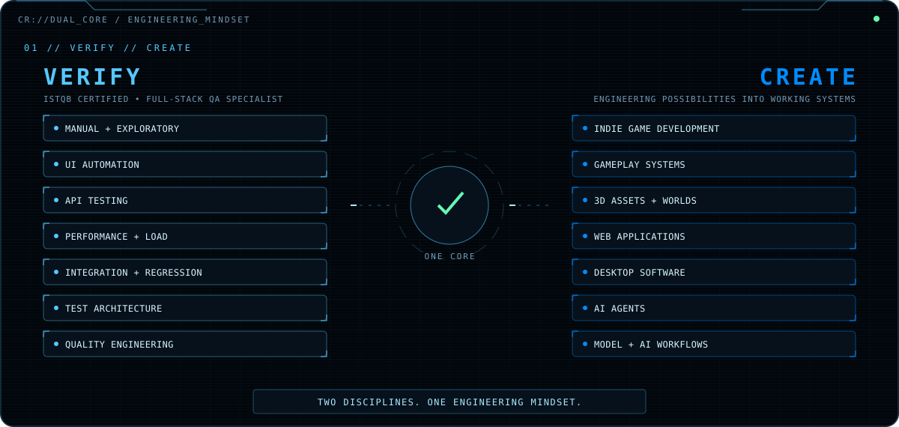
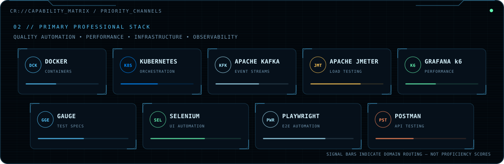
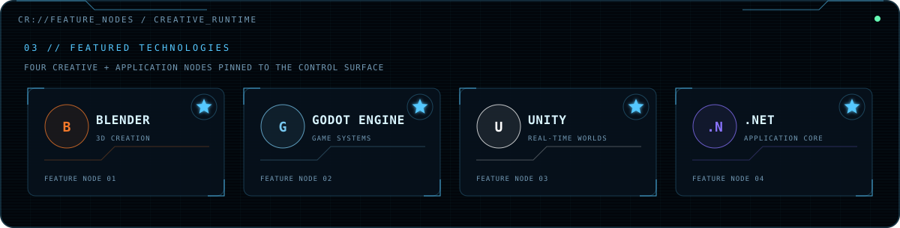
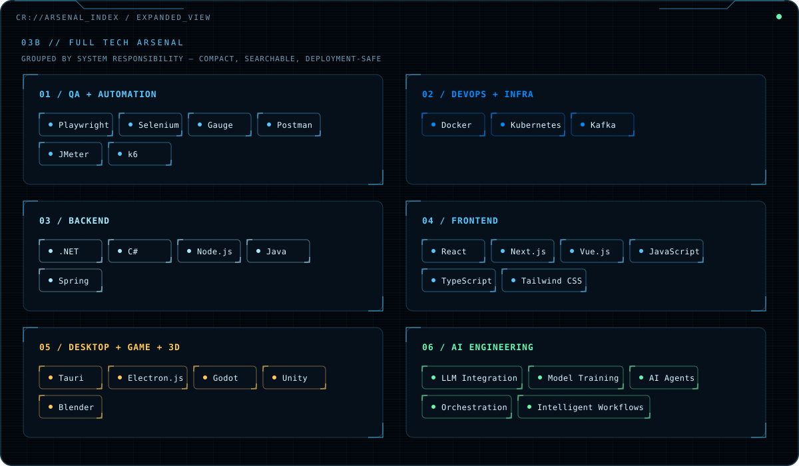
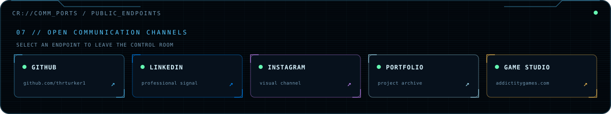

### ISTQB Certified · Full-Stack QA Specialist

**I verify systems. I build worlds. I engineer intelligence.**

Independent Game Developer · Full-Stack Software Developer · AI & Agent Systems Developer · Founder of Addictity Games

---

## `00 // BOOT SEQUENCE`

The control room joins three practices around one habit: build deliberately, test rigorously, and keep the feedback loop visible.

## `01 // VERIFY ↔ CREATE`

## `02 // PRIMARY CAPABILITY MATRIX`

## `03 // FEATURE NODES`

<code>EXPAND FULL TECH ARSENAL</code>

 

The inventory groups tools by the job they perform: QA and automation, infrastructure, backend, frontend, desktop/game development, and AI engineering. Signal bars elsewhere in this README are interface decoration—not proficiency scores.

## `04 // ADDICTITY GAMES`

## `05 // AGENT FABRIC`

I work on LLM-powered applications, AI agents, tool orchestration, workflow automation, integrations, and model experimentation/training workflows. The diagram is a conceptual systems map, not a claim about a private implementation.

## `06 // PUBLIC TELEMETRY`

This panel is generated locally from the public GitHub API. A scheduled workflow refreshes it without sending profile traffic through a third-party statistics service; if the API is unavailable, the last verified snapshot remains readable.

## `07 // COMMUNICATION PORTS`

[**GITHUB**](https://github.com/thrturker1) &nbsp;·&nbsp;
[**LINKEDIN**](https://www.linkedin.com/in/thrturker/) &nbsp;·&nbsp;
[**INSTAGRAM**](https://www.instagram.com/turkertahirr/) &nbsp;·&nbsp;
[**PORTFOLIO**](https://sevro49.github.io/My-Portfolio/public/index.html) &nbsp;·&nbsp;
[**GAME STUDIO**](https://addictitygames.com)

TAHIR // CONTROL ROOM · BUILD / TEST / CREATE

