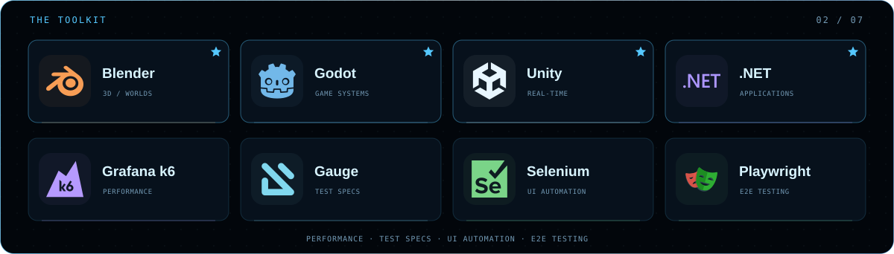

[← Profile](../README.md)

  
  &nbsp; <a href="1.md">01</a> · <strong>02</strong> · <a href="3.md">03</a> · <a href="4.md">04</a> · <a href="5.md">05</a> · <a href="6.md">06</a> · <a href="7.md">07</a> &nbsp;
  

